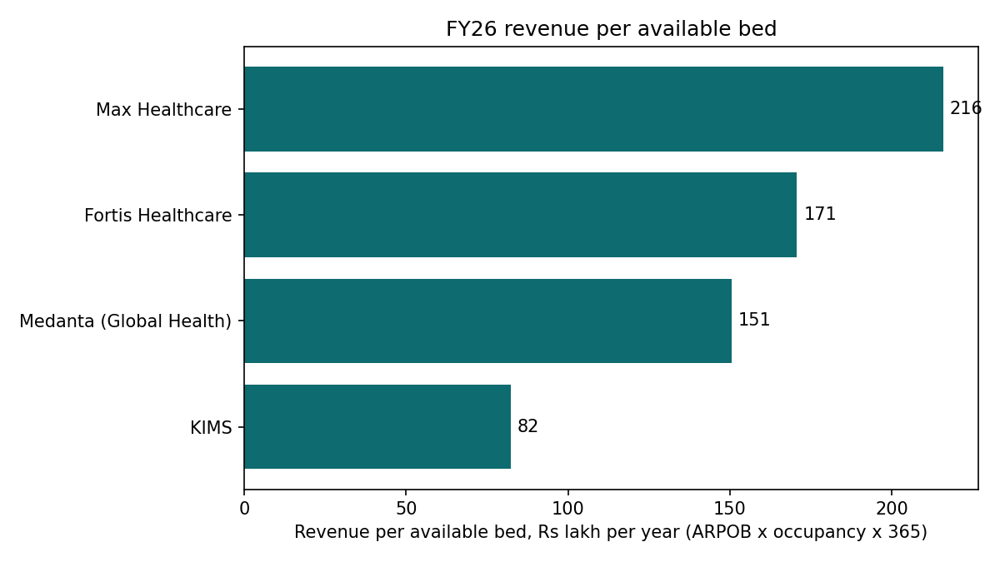
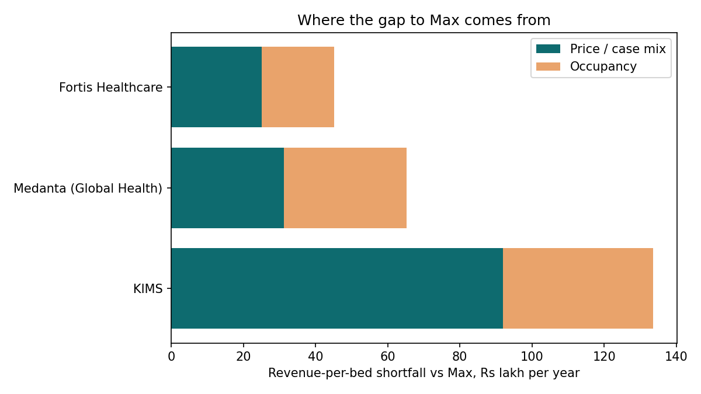

# Why do some Indian hospital chains earn far more per bed? (FY26)

## The answer
Max Healthcare earns about Rs 216 lakh per available bed per year, against Rs 171 lakh at Fortis, Rs 151 lakh at Medanta and Rs 82 lakh at KIMS. **Price and case mix explain roughly half to two-thirds of each gap (Fortis 56%, Medanta 48%, KIMS 69%); occupancy explains the rest.**

For an illustrative 2,000-bed chain, raising occupancy by 5 points adds about Rs 90 Cr of EBITDA (+19%), and cutting average stay by half a day adds about Rs 68 Cr (+14%). Both together lift margin from 20.0% to about 23.3%.

**Recommendation for a mid-sized chain:** fill existing beds before adding new ones, shift case mix toward complex specialties, and stage new capacity so it does not dilute group margin.

## How confident am I
- Revenue per bed and the gap split are straightforward arithmetic on disclosed numbers (the split is exact by construction).
- The lever sizes depend on two assumptions that are **not** company data: a 45% contribution margin and ARPOB rising 0.5% per 1% cut in stay. Sensitivity tables in the Excel model show how the answer moves.

## Repo contents
- `Hospital_Benchmarking_Model.xlsx`: peer data, driver analysis, lever model with sensitivity (live formulas).
- `data/peer_data.csv`: the inputs, with a source for each row.
- `analysis/analysis.py`: reproduces the driver analysis and charts (`pip install -r requirements.txt`, then `python analysis/analysis.py`).
- `DATA_LOG.md`: where the data came from and every cleaning step.
- `SOURCES.md`: source list.
- `docs/`: slide deck PDF.

## Assumptions and limitations
- Margin definitions differ across chains (network, hospital-only, with or without new hospitals).
- Apollo reports revenue per patient rather than ARPOB, and Narayana does not report occupancy, so both are excluded from the driver split.
- Max's ARPOB is an average of four quarterly figures; Medanta's figures are rounded from quarterly disclosures.
- Some figures come from press summaries of company releases and should be checked against the original filings.
- One year of data. This is a student analysis, not investment advice.

## Process
Built with AI assistance (Claude), with data compiled from public results disclosures. Author: Gourang Chandrakar, B.Tech Biomedical Engineering, MIT Manipal.
